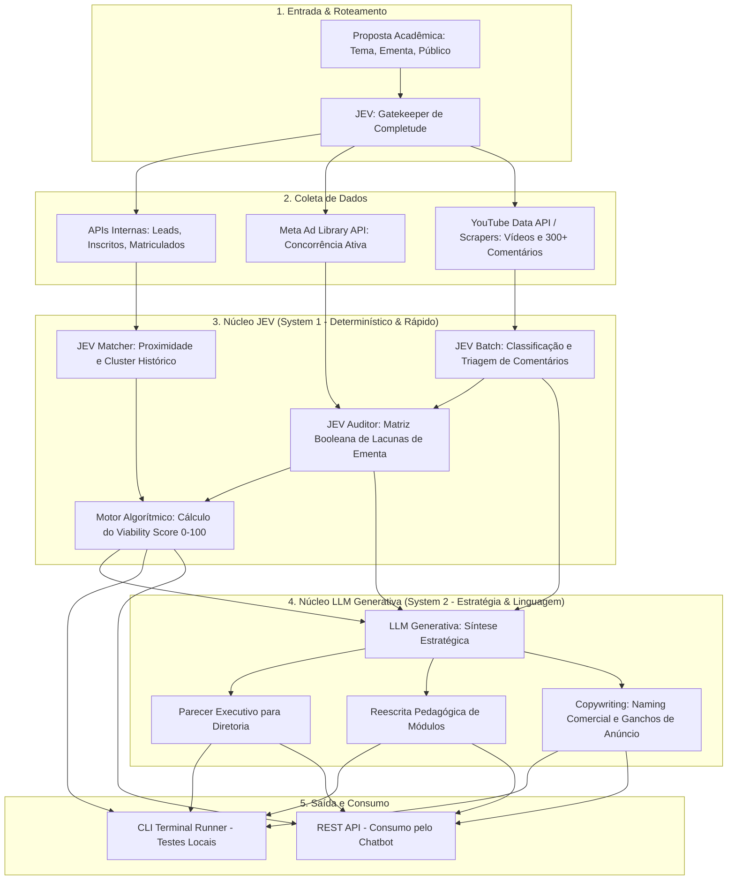

> [!WARNING]
> Documento histórico de origem. Foi substituído pelo PRD canônico em
> [`docs/product/PRD.md`](docs/product/PRD.md). As metas, integrações e fórmulas
> abaixo não devem ser implementadas sem consultar a documentação canônica.
> O status "Aprovado para Implementação" abaixo refere-se apenas à versão 2.0.
> As diferenças deliberadas estão em
> [PRD canônico §14 — Relação com o PRD de origem](docs/product/PRD.md#14-relação-com-o-prd-de-origem).

# Product Requirements Document (PRD) - Versão 2.0 (Arquitetura Híbrida)
## Agente de Inteligência e Validação de Lançamento de Cursos (EdTech Market & Academic Intelligence)

* **Versão:** 2.0.0
* **Status:** Aprovado para Implementação
* **Arquitetura Primária:** Arquitetura Híbrida (JEV System 1 + LLM Generativa System 2) / Headless / REST API & CLI
* **Público-alvo:** Coordenadores Acadêmicos, Diretorias de Novos Produtos e Times de Marketing/Vendas

---

## 1. Visão Geral & Problema de Negócio

### 1.1. O Problema
Novas propostas de cursos surgem a partir de uma ótica predominantemente acadêmica, resultando em:
1. **Descompasso com a Demanda Real:** Cursos criados sem validação prévia de interesse, concorrência ativa ou volume de buscas.
2. **Subutilização da Base Histórica:** A instituição possui dados valiosos de funil (*Leads, Inscritos, Matriculados*), mas eles não são correlacionados com novos lançamentos.
3. **Ineficiência de Processamento de Mercado:** Avaliar centenas de sinais em redes sociais e concorrência manualmente (ou com LLMs puras) é lento, caro e propenso a inconsistências.

### 1.2. A Solução: Arquitetura Híbrida (JEV + LLM Generativa)
A união do melhor de dois paradigmas de inteligência artificial:
* **JEV (TypeSafe AI - System 1):** Modelo discriminativo ultra-rápido (<100ms) e determinístico. Atua como o *cérebro analítico*: valida a integridade da proposta, categoriza em lote centenas de comentários de redes sociais, executa auditorias booleanas de conformidade de ementa e alimenta um cálculo matemático imune a alucinações.
* **LLM Generativa (Gemini / Claude / GPT - System 2):** Modelo de raciocínio verbal e síntese. Recebe os dados já estruturados e quantificados pelo JEV e foca exclusivamente no que faz melhor: redação do dossiê executivo para a diretoria, reestruturação pedagógica de módulos e copywriting comercial para marketing.
* **Entrega Desacoplada:** Backend em Python com interface CLI colorida para testes imediatos no terminal e endpoints REST (FastAPI) para plugar no Chatbot existente e futuros dashboards.

---

## 2. Objetivos e Critérios de Sucesso

| Objetivo | Métrica / Critério de Sucesso |
| :--- | :--- |
| **Tempo de Execução (E2E)** | Redução de ~45s para **menos de 10 segundos** em toda a varredura e síntese. |
| **Custo de Inferência** | Redução de até **85% no custo de tokens**, delegando processamento em lote ao JEV (~$0,042/1M tokens). |
| **Determinismo do Score** | Viability Score (0 a 100) 100% reprodutível e auditável matematicamente. |
| **Qualidade Consultiva** | Parecer final prático, com dados quantitativos de funil histórico e sugestões cirúrgicas de ementa. |

---

## 3. Arquitetura do Sistema: Divisão de Responsabilidades (JEV vs. LLM)



---

## 4. Matriz de Atribuição Técnica

### 4.1. Papel do JEV no Pipeline
1. **Gatekeeper de Entrada:** Validação rápida se a proposta possui os elementos mínimos necessários para uma análise de viabilidade confiável (`ProposalReadiness: bool`).
2. **Classificador em Lote de Redes Sociais (Social Listening):**
   * Classifica 200 a 500 comentários coletados em categorias tipadas:
     * `categoria_dor`: `[MUITO_TEORICO, PRECO_ELEVADO, FALTA_APLICACAO_PRATICA, DUVIDA_REQUISITO, OUTROS]`
     * `sentimento_dor`: `Score de 0.0 a 1.0`
   * Agrupa os volumes percentuais das queixas sem gerar alucinação de dados.
3. **Auditoria de Conformidade da Ementa (Compliance Matrix):**
   * Avalia perguntas booleanas precisas:
     * *A ementa atual resolve a queixa de 'falta de aplicação prática'?* $\rightarrow$ `false`
     * *A ementa menciona as ferramentas mais requisitadas nas vagas de mercado?* $\rightarrow$ `true`
4. **Alimentação do Cálculo Numérico:**
   * Alimenta a fórmula determinística do **Viability Score**, garantindo consistência estatística.

### 4.2. Papel da LLM Generativa no Pipeline
1. **Redação do Dossiê Executivo:** Sintetiza a visão holística em linguagem formal e consultiva para coordenadores e diretores.
2. **Recomendação e Reescrita Curricular:** Transforma os diagnósticos do JEV em melhorias concretas (ex: *"Substituir a aula teórica 3 pelo workshop prático de X, cobrindo a lacuna apontada por 42% dos interessados"*).
3. **Engenharia de Posicionamento e Marketing:** Cria alternativas comerciais de títulos, subtítulos e argumentos de vendas para os times de tráfego e captação.

---

## 5. Modelagem de Dados & Contratos

### 5.1. Dossiê de Saída Híbrido (`CourseViabilityResponse`)
```json
{
  "id_analise": "anl_20261009_002",
  "titulo_avaliado": "Inteligência Artificial Aplicada aos Negócios",
  "data_analise": "2026-10-09T14:45:00Z",
  
  "metricas_deterministicas": {
    "viability_score_final": 86.4,
    "score_historico_interno": 82.0,
    "score_validacao_concorrencia": 90.0,
    "score_demanda_social": 88.5,
    "score_aderencia_ementa": 75.0,
    "status_recomendacao": "APROVADO_COM_AJUSTES"
  },

  "diagnostico_jev": {
    "nichos_historicos_relacionados": ["CURSO_HIST_102", "CURSO_HIST_088"],
    "funil_historico_medio": {
      "leads": 1420,
      "inscritos": 210,
      "matriculados": 74,
      "conversao_lead_matricula": 0.052
    },
    "concorrentes_ativos_meta_ads": 24,
    "social_top_dores_quantificadas": [
      { "dor": "Falta de aplicabilidade prática / Muito teórico", "incidencia_percentual": 41.5 },
      { "dor": "Dificuldade de calcular ROI em empresas reais", "incidencia_percentual": 27.8 },
      { "dor": "Medo de custos altos com ferramentas de IA", "incidencia_percentual": 16.2 }
    ],
    "matriz_conformidade_ementa": {
      "atende_pratica_sem_codigo": false,
      "atende_calculo_de_roi": false,
      "atende_seguranca_lgpd": true
    }
  },

  "sintese_estrategica_llm": {
    "resumo_executivo": "O curso possui demanda comprovada por 24 anunciantes ativos no Meta Ads e forte tração nas redes. Contudo, há uma lacuna crítica na ementa atual: ela falha em abordar a maior queixa dos alunos (a falta de prática real sem programação). Ajustando os módulos 2 e 3, o potencial de conversão aumenta substancialmente.",
    "ajustes_recomendados_ementa": [
      "Substituir 'História e Arquitetura de Redes Neurais' por 'Laboratório Prático de IA No-Code em Processos Corporativos'",
      "Adicionar oficina obrigatória: 'Como Apresentar o ROI de Projetos de IA para a Diretoria'"
    ],
    "opcoes_naming_comercial": [
      "MBA Executivo em IA e Automação de Negócios",
      "Especialização em Inteligência Artificial para Gestores e Líderes"
    ],
    "ganchos_para_marketing": [
      "Aprenda a liderar projetos de IA sem precisar escrever uma linha de código",
      "O método prático para calcular o retorno financeiro de automações na sua empresa"
    ]
  }
}
```

---

## 6. Fases de Implementação & Roadmap Técnico

### Fase 1: Fundação do Backend & Contratos
* Configuração do ambiente Python (FastAPI, Pydantic, HTTPX, Typer/Click para CLI).
* Modelagem dos contratos de entrada e saída.
* Adaptadores para as 3 APIs da instituição (Leads, Inscritos, Matriculados) com mocks de suporte a testes.

### Fase 2: Integração da Camada JEV (System 1)
* Implementação do client do JEV com schemas tipados para:
  * Gatekeeper de proposta.
  * Classificador em lote de comentários de redes sociais (Social Listening).
  * Matriz booleana de auditoria de ementa.
* Algoritmo matemático para cálculo auditável do *Viability Score*.

### Fase 3: Conectores Externos
* Conector Meta Ad Library API (anúncios ativos e longevidade).
* Conector YouTube Data API / Scrapers (vídeos em alta e comentários).
* Conector Google Trends.

### Fase 4: Integração da LLM Generativa (System 2)
* Prompts especializados recebendo o payload mastigado do JEV.
* Geração do parecer executivo, refinamento de ementa e ganchos de copywriting.

### Fase 5: CLI de Validação & Exposição de Endpoints REST
* CLI rico com tabelas formatadas (`rich`) para execução e testes via terminal.
* Endpoints REST (FastAPI) documentados via Swagger/OpenAPI prontos para consumo pelo Chatbot do usuário.
