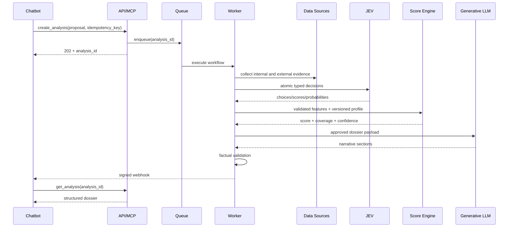

# Fluxo de dados

## Sequência principal

## Imutabilidade

Entradas, evidence items, decision results, scoring profile e dossier recebem versões. Correções produzem nova análise ou revisão vinculada; não alteram silenciosamente o passado.

## Idempotência

- Criação: chave fornecida pelo chatbot.
- Coleta: chave por instituição, fonte, consulta e janela.
- Webhook: `event_id` único.
- Reprocessamento: cada step possui chave e estado próprios.

## Dados não confiáveis

HTML, comentários, descrições, documentos e resultados de scraping são isolados como conteúdo. Nunca são concatenados a instruções de sistema sem delimitação, sanitização e política de tamanho.
