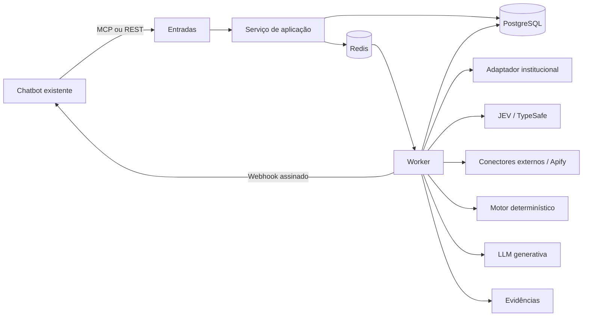

# Visão do sistema

## Estilo

Monólito modular headless, com processamento assíncrono e deployment isolado por instituição.

## Componentes executáveis planejados

- `api`: REST, health checks e callbacks administrativos.
- `mcp`: ferramentas de alto nível para o chatbot.
- `worker`: execução do workflow.
- `scheduler`: manutenção, retentativas e reconciliação.
- `postgres`: estado transacional e auditoria.
- `redis`: fila, locks, cache transitório e rate limiting.

API, MCP, worker e scheduler compartilham o mesmo pacote de domínio e aplicação, mas possuem entrypoints separados.

## Princípios

- Portas e adaptadores para provedores externos.
- Domínio sem dependência de FastAPI, Redis, SDKs ou fornecedores.
- Estado explícito e transições validadas.
- Jobs longos nunca dependem de uma conexão HTTP aberta.
- Evidência antes de narrativa.
- Configuração institucional externa ao código.
