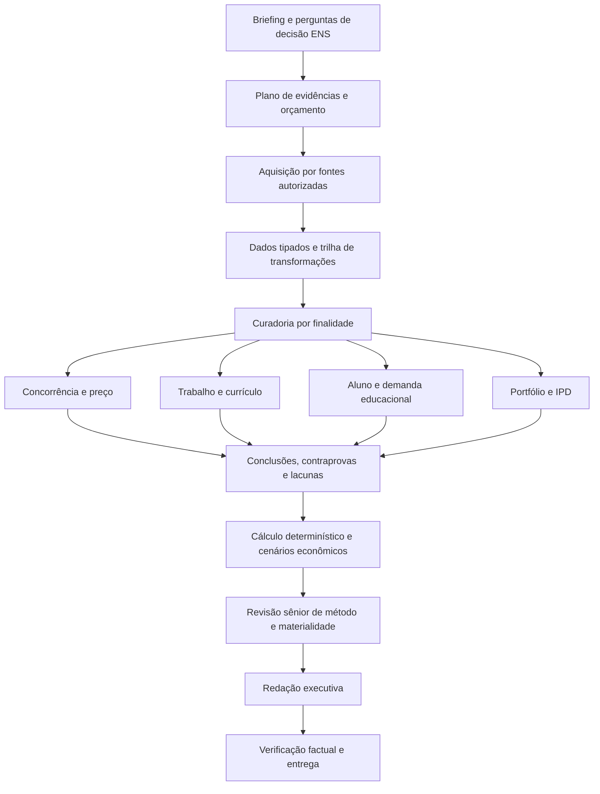

# Auditoria completa da inteligência de mercado do Prometeus para a ENS

Consolidação: **30/10/2026**. Evidências do caso e consultas públicas: 29/10/2026. Responsável pelo produto: Agência Prometeus. Status: **auditoria concluída; sistema precisa de revisão para sustentar um parecer de mercado de nível sênior**. Este documento não declara implementadas as melhorias propostas.

## Parecer executivo

O problema não se resume à capacidade da LLM nem à qualidade da Apify. Há defeitos comprovados em cinco camadas: tradução do plano em inputs dos Actors, amostragem dos retornos, preservação dos dados, seleção de evidências e desenho do scoring. A redação e seu verificador recebem uma base que já perdeu informação. Um dossiê pode passar na verificação factual dessa base e continuar incompleto como análise de mercado.

O E2E anterior demonstrou que o fluxo consegue concluir e publicar um dossiê após correções e retomadas. **Não demonstrou qualidade sênior de pesquisa, precisão da qualificação ou validade comercial do score.** A recomendação publicada de evidências insuficientes não é uma estimativa confiável de ausência de mercado enquanto esses defeitos não forem corrigidos e reavaliados.

É necessário preservar a distinção entre quatro situações:

1. Não há dado porque a fonte não foi consultada ou falhou.
2. O dado foi recebido, mas se perdeu ou foi interpretado incorretamente.
3. O dado é válido, porém não responde à pergunta comercial.
4. O dado responde à pergunta e indica oportunidade fraca, forte ou incerta.

Hoje, as quatro podem terminar no mesmo rótulo de insuficiência. O plano recomenda corrigir primeiro as perdas e os contratos, medir os julgamentos com referência humana e só então ampliar pesquisa e especialização dos agentes. Trocar para JEV ou instalar uma skill genérica não resolve defeitos na entrada comum aos dois modos.

## Escopo, evidências e limites

Foi inspecionado o conjunto completo de 144 capturas da análise `73501c53-cc58-47f9-8927-d9e299b4f4b5`, as consultas e parâmetros persistidos, decisões, fontes factuais e dossiê. Foram examinados código, prompts, dez skills locais, rubricas, perfis de scoring, contratos tradicional/JEV e testes. Três frentes independentes cobriram coleta, integridade/decisões e metodologia de mercado; os achados foram confrontados com a implementação e reproduções offline.

Fontes do trabalho:

- [Pacote dos 144 registros](../../Estudo_Prometeus_144_registros_73501c53_2026-10-29/COMO_ESTUDAR.md).
- [Baseline quantitativo e hashes dos arquivos](senior-market-intelligence-baseline-2026-10-29.json).
- [Verificações offline reproduzíveis](senior-market-intelligence-baseline-checks-2026-10-30.py), sem rede ou alteração de dados.
- [Apêndice de pesquisa e Apify](senior-market-intelligence-research-2026-10-29.md), com linhas de código e documentação dos Actors.
- [Apêndice de dados, decisões e scoring](senior-market-intelligence-data-2026-10-29.md), com reproduções e casos de contrato.
- [Apêndice metodológico](senior-market-intelligence-methodology-2026-10-29.md), com critérios de viabilidade e fontes primárias.
- [Plano de implementação por fases](../../plans/2026-10-30-senior-market-intelligence.md).

O hash factual do caso é `7761d831324c2e5130258bc80691f4e3b8c9367afff5677cc4a0a890710f7a6e`. A exportação permite reconstruir projeções de entrada, mas não contém um log integral autenticado de cada prompt ou POST histórico. Os limites dessa reconstrução acompanham os achados.

Não foram feitas novas inferências, coletas pagas, instalações, alterações de score, reclassificações ou mudanças de estado nesta auditoria. O histórico institucional é sintético. R$ 100 × 12 e um mês de duração da extensão são parâmetros do teste automatizado; não foram validados como condição comercial oficial da ENS. O preço de R$ 976 × 20 informado pelo usuário pertencia a outro MBA. Esses contextos não podem ser misturados.

A análise é um estudo de caso profundo, não uma amostra representativa de todos os cursos ou de todo o desempenho do agente. Sem rótulos independentes, não podemos calcular precisão/recall, taxa de falso descarte ou uma nota honesta de “qualidade da IA”.

## O que os números realmente mostram

| Medida | Resultado observado | Significado e limite |
|---|---:|---|
| Capturas persistidas | 144 | Não são 144 entidades independentes nem tamanho de mercado |
| Para indicadores / contexto / excluídas | 17 / 73 / 54 | Classificação do pipeline, não validação humana |
| Rendimento para indicadores | 11,8% | 17/144; não mede acerto do classificador |
| Entradas reconstruídas acima de 14 mil caracteres | 20/144 | Há corte por tamanho; relevância da perda deve ser avaliada por campo |
| Descrições de vagas ausentes do resumo factual | 28/30 | Inclui 16/16 vagas aceitas para indicadores |
| Pontos Trends com timestamp alterado | 786/786 | 262 em cada uma das três capturas; há repetição de série |
| `quality_score` igual a 1,0 | 144/144 | O campo mede essencialmente penalidade de regex de injection, não qualidade analítica |
| Qualificações com confiança declarada ≥95% | 87/144 | Confiança do modelo sem calibração contra rótulos independentes |
| Consultas de ferramentas | 19 | 15 com sucesso, três vazias, uma parcial |
| Custo Apify registrado | US$ 0,311142 | Não é custo total de modelos nem reconciliação completa de faturamento remoto |

Por fonte:

| Fonte | Capturas | Indicadores | Contexto | Excluídas | Observação material |
|---|---:|---:|---:|---:|---|
| Google Search | 46 | 0 | 24 | 22 | Quarenta URLs canônicas; descoberta não virou oferta verificada |
| Crawler | 14 | 0 | 8 | 6 | Inclui 404 e páginas de outros temas; um PDF priorizado sem outcome registrado |
| LinkedIn empresas | 10 | 0 | 10 | 0 | Consulta específica convertida pelo mapper em “seguros” |
| LinkedIn vagas | 30 | 16 | 12 | 2 | Descrições recebidas, mas omitidas da base de redação |
| Meta Ads | 11 | 0 | 10 | 1 | Seis IDs de anúncio; cinco anúncios próprios repetidos entre consultas |
| TikTok | 15 | 0 | 0 | 15 | Dez textos em espanhol, quatro em português, um em inglês; quatro fora dos 12 meses declarados |
| YouTube | 15 | 1 | 9 | 5 | Todos de um vídeo, embora dez URLs fossem resolvidas |
| Trends | 3 | 0 | 0 | 3 | Séries existentes ficaram fora do corte de entrada da qualificação |
| Instagram | 0 | 0 | 0 | 0 | Retorno diagnóstico sem itens; corretamente não virou evidência |

Os motivos da classificação ficam preservados, mas vários são categorias operacionais genéricas. Não são uma explicação individualizada de todos os critérios de mercado nem a cadeia interna de raciocínio do modelo.

## Achados que impedem confiar na análise atual como parecer sênior

Severidade usada: **P1** = risco material para dados, conclusão ou uso em produção; **P2** = lacuna relevante de método, medição ou manutenção. “Observado” indica efeito no caso; “reproduzido offline” indica defeito demonstrado em uma entrada controlada; “lacuna” indica requisito sem implementação ou evidência suficiente. Não há alegação de incidente JEV real.

| ID | Prioridade / evidência | Problema | Consequência | Frente de correção |
|---|---|---|---|---|
| A01 | P1 observado | JSON bruto cortado em 14 mil caracteres | Série Trends começa depois do corte; classificador não recebe o sinal principal | Projeção tipada por finalidade, com perdas explícitas |
| A02 | P1 observado | Sanitizador interpreta timestamps como telefone | Cronologia e ordenação podem ser corrompidas | Sanitização por tipo/campo; preservar identificadores, datas e medidas |
| A03 | P1 observado | Redator não recebe `descriptionText`/`descriptionHtml` de vagas | Aderência curricular discutida com título e empresa, embora requisitos existam | Normalizador de vagas e mapa fonte → competência → ementa |
| A04 | P1 observado/reproduzido | Fontes/features atuais não sustentam o gate de confiança | Corrigir coleta não basta para sair de insuficiência | Matriz de alcançabilidade e calibração; não baixar gate para passar |
| A05 | P1 observado | YouTube limita por vídeo no Actor, mas lê primeiros 15 do dataset | Total reportado de 44 itens, quinze persistidos de um vídeo; diversidade planejada se perde | Unidades de cota, paginação e seleção por vídeo/canal |
| A06 | P1 observado/código | Período/idioma/região planejados não são integralmente traduzidos | Ruído e falsa impressão de recorte aplicado | Input efetivo, filtros suportados e pós-filtro observado |
| A07 | P1 observado | URLs do crawler selecionadas por ordem, sem priorização por pergunta | Cota usada em páginas inadequadas; sem resposta para cada alvo | Descoberta, ranking, aquisição e outcome por ativo separados |
| A08 | P1 observado | Recuperação vê ausência de feature, sem identificar causa interna | Repetição paga de Trends para compensar problema de processamento | Diagnóstico causal antes de nova coleta |
| A09 | P1 reproduzido offline | Contratos de resposta não são igualmente estritos | Tradicional aceita booleano/distribuição inválida; cliente JEV pode assumir primeira opção ausente | Schema comum estrito, erro seguro e abstenção explícita |
| A10 | P1 lacuna | Factualidade é avaliada sobre base já empobrecida | Verificador pode aprovar texto fiel a um resumo incompleto | Revisor de integridade da base separado do revisor de claims |
| A11 | P2 observado | `quality_score=1` e confiança ≥95% sem gold | Métricas aparentam qualidade que não foi medida | Scorecard de qualidade por dimensão e calibração |
| A12 | P2 reproduzido/observado | Comparabilidade por tokens genéricos e presença de grade | “Extensão em Culinária” pode compartilhar tema por “extensão”; IPD com baixa similaridade ganha confiança alta | Comparabilidade multidimensional e opção de menos de três cursos |
| A13 | P2 observado | Captura, entidade, consulta e amostra confundidas | Duplicação de contexto e custo; contagens sem independência | Identidades canônicas e proveniência de cada captura |
| A14 | P2 lacuna | Modelo real/input/transformações incompletos na auditoria e cache | Não há replay exato nem invalidação completa após troca de modelo/projetor | Envelope de execução versionado e cache por input efetivo |
| A15 | P1/P2 lacuna | Não há motor econômico-financeiro completo ou SWOT estruturada | Score de preço é apresentado dentro de viabilidade sem cobrir margem, caixa e risco | Módulos de economia e parecer estratégico com dados necessários |
| A16 | P2 hipótese não calibrada | Mais anúncios elevam mecanicamente nota | Atenção comercial e pressão competitiva ficam misturadas | Separar sinais, testar direção e backtest sem mudar perfil silenciosamente |

Os apêndices detalham os arquivos/linhas de cada achado. Falhas latentes adicionais incluem geografia por regex incompleta de UFs, parâmetros semânticos removidos da identidade de URLs e variante `isPartial=[true]` não tratada como parcial. Elas exigem regressões, mas não foram atribuídas como causa comprovada deste dossiê.

## Por que o resultado tende a “evidências insuficientes”

O perfil experimental exige cobertura mínima de 80%, confiança de 75% e presença dos pilares histórico e busca. A confiança atual penaliza ausência de componentes de cada pilar; o dado de qualidade do modelo não é o único fator.

| Pilar | Componente disponível neste conjunto | Confiança resultante no cenário |
|---|---|---:|
| Histórico | IPD com referência e grade sintética | 0,900 |
| Concorrência paga | Contagem de anúncios, sem índice de concorrência | 0,440 |
| Busca recuperada | Interesse relativo + crescimento, sem volume mensal absoluto | 0,506 |
| Empregabilidade | Contagem, sem mediana salarial normalizada | 0,510 |
| Aderência | Nota sem percentual de necessidades cobertas separado | 0,675 |
| Preço | Uma origem de referência | 0,500 |

No caso publicado, cinco pilares presentes dão cobertura 0,8 e confiança 0,6198. A sensibilidade offline acrescentou valores ilustrativos de Trends apenas para testar o mecanismo. Com os seis componentes da tabela, a confiança passa a aproximadamente **0,5970**, porque uma nova dimensão menos confiável reduz a média. Acrescentar também preços das duas origens levaria esse cenário a **0,6270**. Ambos ficam abaixo de 0,75.

Isso **não prova impossibilidade matemática geral**: com todos os componentes opcionais disponíveis, o motor admite cerca de 0,8825 nessas outras premissas. Demonstra incompatibilidade operacional entre as fontes/features produzidas e os requisitos atuais. Essa simulação não é uma nova nota do curso, não recupera demanda e não foi publicada no app.

Volume mensal de busca, índice de concorrência, CPC, mediana salarial tipada e percentual de dores cobertas não aparecem como features prontas nos 144 registros. Há campos que o extrator sabe ler em fixtures, mas que os produtores reais não fornecem ou não normalizam. Um teste positivo usando esses campos inventados não prova alcançabilidade com o pipeline real.

**Decisão proposta:** preservar os pesos e o IPD acordados; versionar qualquer mudança de perfil; explicitar por que um gate falhou; separar completude, qualidade da fonte, força da evidência e confiança semântica; calibrar com casos reais e decisão ENS. Não otimizar taxa de aprovação nem remover a exigência de evidência.

## Arquitetura recomendada: papéis especializados com contratos comuns

Não recomendo começar com uma equipe autônoma grande trocando mensagens livres. Recomendo papéis especializados em um workflow controlado, com artefatos tipados, orçamento e transições em código. Papéis podem ser chamadas distintas à mesma LLM; paralelismo só onde há independência e ganho mensurável.

| Papel | Entrada e entrega obrigatórias | Limite de autoridade |
|---|---|---|
| Diretor de pesquisa | Briefing → perguntas, hipóteses, requisitos de evidência, fontes e plano de parada | Não define nota nem autoriza gasto fora do teto |
| Especialista de aquisição | Plano → inputs efetivos, resultados, paginação, recorte aplicado e outcomes | Actors allowlisted e builds validados; sem discovery executável irrestrito |
| Curador de dados | Retorno → observações, campos/trechos, qualidade e utilidade por finalidade | Não transforma ausência em zero nem cria preço faltante |
| Analista de concorrência/preço | Ofertas → diretas/adjacentes/substitutas, comparabilidade e preços atribuídos | Preserva regra ENS da média; não confunde ausência de preço com ausência de oferta |
| Analista de trabalho/currículo | Vagas e fontes setoriais → competências e mapa de cobertura por módulo | Vaga é sinal profissional, não intenção de matrícula |
| Analista de demanda de alunos | CRM, pesquisa primária e busca educacional → segmentos, barreiras, intenções e testes | Não converte trabalhadores, views ou prêmios de seguros em alunos |
| Analista de portfólio/IPD | Cursos/coortes → até três comparáveis, IPDs, limites e canibalização possível | Fórmula 20/30/50 em código; menos de três é permitido; sintético não vira validação comercial |
| Analista econômico | Premissas ENS → cenários explicados e sensibilidade | Cálculos, unidades e arredondamento em código; sem custo não há margem calculável |
| Revisor sênior | Conclusões → parecer de suficiência por pergunta, contraprovas, omissões e alternativas | Não substitui a decisão institucional nem eleva confiança para destravar publicação |
| Redator e revisor factual | Pacote aprovado → narrativa citável, limitações e ação útil | Redator não altera fatos/nota; verificador não presume que base factual completa foi recebida |

Modo **tradicional**: LLM executa entendimento, planejamento, extração semântica, julgamentos delimitados, análises e redação, com validação em código. Modo **híbrido**: mesmos dados e contratos; JEV substitui apenas tarefas atômicas aprovadas em shadow. Planejamento, síntese e integração analítica permanecem na LLM tradicional. O cliente JEV deve ser endurecido antes de qualquer homologação híbrida.

## O que deve constar em uma análise de viabilidade sênior

| Pergunta de decisão | Entrega analítica | Evidências e limites |
|---|---|---|
| Qual problema de quem será resolvido? | Segmentos, comprador/beneficiário, JTBD, barreiras e alternativas | Briefing, CRM e entrevistas; não apenas interpretação de hashtags |
| Onde a oferta entra no portfólio ENS? | Categoria exata, família estatística, sinergia/canibalização, até três comparáveis | Catálogo e ementas oficiais; funis/coortes reais para validação comercial |
| Quais concorrentes e substitutos existem? | Quadro de ofertas diretas/adjacentes com conteúdo, modalidade, carga, credencial e condições | Páginas oficiais e data da condição; comparabilidade por dimensão |
| Há necessidade profissional? | Empregadores, atividades, skills e matriz módulo → necessidade → fonte | Vagas únicas, fontes oficiais e entrevistas; não garante empregabilidade |
| Há procura pela formação e disposição a pagar? | Intenção educacional, funil, barreiras de preço, evidência comportamental | Busca, leads qualificados, entrevistas e pilotos; proxies separados de matrícula |
| O curso fecha economicamente? | Margem, equilíbrio, capacidade, caixa e cenários | Custos/prazos informados e validados; cálculos determinísticos |
| Quais opções e riscos existem? | SWOT/TOWS e alternativas de lançar, ajustar, pilotar ou suspender | Cada item ligado a evidência, premissa ou hipótese; dado ausente é pendência, não fraqueza inventada |
| O que pode mudar a decisão? | Lacunas materiais, próximo teste, responsável e critério de sucesso | Valor da informação e custo; não uma lista genérica de “pesquisar mais” |

A SWOT deve separar forças/fraquezas internas de oportunidades/ameaças externas. Reputação, qualidade docente e vantagem institucional exigem fatos ENS. TOWS liga cruzamentos a ações testáveis. A análise financeira mantém preço de referência separado de rentabilidade: receita líquida realizável, custos fixos/variáveis, aquisição, capacidade, recebimentos e pagamentos precisam de inputs próprios. O apêndice metodológico especifica fórmulas e prevenção de dupla contagem de mídia/CAC.

## Como medir a qualidade sem fabricar uma nota geral

O score de viabilidade do curso não pode servir como score de qualidade da pesquisa. Aumentar a nota do curso ou aceitar mais registros não é o objetivo. É necessário um scorecard de qualidade por etapa:

| Etapa | Medida / denominador | Referência necessária |
|---|---|---|
| Pesquisa | Perguntas com fonte capaz e recorte verificável / perguntas aplicáveis | Rubrica ENS e catálogo de capacidades |
| Aquisição | URLs com outcome / URLs selecionadas; filtros aplicados ou indisponíveis / filtros requeridos | Logs/input efetivo e schema do Actor |
| Amostragem | Entidades/vídeos/canais distintos e itens adquiridos versus retidos | Unidade e cota explícitas; não total de mercado |
| Integridade | Campos críticos preservados corretamente / campos críticos esperados | Pares raw → normalizado adjudicados |
| Extração | Precisão/recall de preços, categorias, skills, datas e unidades | Gold por campo e finalidade |
| Curadoria | Precisão, recall e falsos descartes por finalidade; matriz de confusão | Dois revisores independentes e adjudicação |
| Scoring | Proveniência completa, resultados exatos, alcance dos gates, sensibilidade | Fixtures de produtores reais e aprovação das regras ENS |
| Redação | Claims materiais sustentadas e respostas às perguntas aplicáveis | Revisor factual + rubrica sênior distinta |
| Revisão | Alucinações que escaparam e afirmações corretas rejeitadas | Controles positivos/negativos e amostra humana |
| Operação | Latência, chamadas, tokens/cota e custo por evidência útil nova | Telemetria real; custo desconhecido não deve ser registrado como zero |

Propostas iniciais de aceitação: zero corrupção de campo crítico; zero default semântico para resposta inválida; todas as perdas de conteúdo e limitações de recorte explícitas; nenhuma métrica crítica sem proveniência. Metas de precisão/recall devem ser acordadas por tarefa; sugestão para evidência crítica é recall ≥95% e precisão ≥90% no conjunto de referência inicial, com contagens, intervalos e análise de erro. Esses números são metas propostas, não desempenho atingido nem garantia universal.

Começar pela rotulagem dos 144 registros e ampliar com briefings de MBA/Pós, graduação, extensão, imersão e certificação avançada. Usar exemplos negativos, adjacentes, ambíguos e insuficiência legítima. Separar desenvolvimento e teste por entidade, instituição, curso e período, evitando que capturas duplicadas apareçam nos dois lados. Um especialista ENS de mercado/portfólio e outro de dados/metodologia devem adjudicar os casos importantes. Os agentes desta auditoria não substituem esse gold humano.

## Fontes adicionais, tools e skills

O site [ENS](https://ens.edu.br/) serve a identidade, taxonomia e catálogo institucional, não a desempenho comercial ou matrícula. A leitura textual da homepage não retornou corpo utilizável na consulta; isso exige renderização ou origem autorizada, não a conclusão de que não há cursos. Programas e notícias oficiais devem ter data e status de oferta, e não ser presumidos atuais só porque estão disponíveis.

| Necessidade | Reuso recomendado | Condição para adotar |
|---|---|---|
| Operação Apify | [Skills oficiais Apify](https://github.com/apify/agent-skills), sobretudo seleção/schema/integração | Auditar arquivos/commit/licença, adaptar e avaliar; instalação no Codex não ativa runtime Prometeus |
| Inspeção de schemas e storages | [MCP oficial Apify](https://docs.apify.com/mcp) | Opcional para manutenção/sandbox; não é necessário migrar REST para corrigir o caso |
| Busca com volume absoluto | [Google Ads Keyword Planning](https://developers.google.com/google-ads/api/docs/keyword-planning/overview) | Validar conta/acesso/quota; estimativa de buscas não é matrícula |
| Triangulação de vagas | [Indeed Actor](https://apify.com/misceres/indeed-scraper/input-schema) e páginas de empregadores | Testar cobertura brasileira, custos e dedupe; não substituir LinkedIn por reflexo |
| Contexto setorial e trabalho | [SUSEP](https://www.gov.br/susep/pt-br/fale-conosco/consultar-estatisticas-do-mercado), [MTE/PDET](https://www.gov.br/trabalho-e-emprego/pt-br/assuntos/estatisticas-trabalho), [INEP](https://www.gov.br/inep/pt-br/areas-de-atuacao/pesquisas-estatisticas-e-indicadores/censo-da-educacao-superior/), [IBGE](https://www.ibge.gov.br/estatisticas/sociais/populacao/9171-pesquisa-nacional-por-amostra-de-domicilios-continua) | Validar recorte/licença/acesso; emprego formal e prêmios de seguro não são demanda educacional; INEP não cobre todo MBA/extensão |
| Avaliação comparativa | pytest e runner local; [Promptfoo](https://www.promptfoo.dev/docs/intro/) como candidato | Usar adapter próprio, sem trocar OAuth nem expor dados; validar versão/licença antes de incorporar |
| Metodologia competitiva | [Competitive Brief da Anthropic](https://github.com/anthropics/knowledge-work-plugins/blob/main/marketing/skills/competitive-brief/SKILL.md) | Reaproveitar estrutura após adequação à educação/ENS, não tratar como expertise pronta |
| Economia de cursos | Modelo específico validado com finanças ENS | Skills de fechamento contábil não substituem unit economics de uma turma |

A documentação atual do MCP Apify descreve descoberta/execução/storage e schemas inferidos no hosted. Esses recursos ajudam manutenção, mas não corrigem sozinhos seleção, amostragem ou interpretação. Skills oficiais são um ponto de partida; a skill competitiva comunitária inspecionada contém premissas inadequadas, como recorte EUA e equivalência entre zero vagas e ausência de contratação. Não adotar sem revisão.

A avaliação deve ser versionada e reproduzível, apoiada por especialistas humanos. Isso segue a distinção entre testes de software e avaliações probabilísticas descrita em [Evaluation best practices](https://developers.openai.com/api/docs/guides/evaluation-best-practices). Não recomendo iniciar uma dependência nova na plataforma legada OpenAI Evals: o [calendário oficial consultado](https://developers.openai.com/api/docs/deprecations) informa transição para somente leitura em 31/10/2026 e encerramento previsto para 30/11/2026. O plano usa artefatos/runner locais e é independente dessa plataforma.

## Ordem de investimento

1. **Medir e preservar:** baseline, gold e rastreabilidade, sem nova compra de dados.
2. **Consertar integridade:** tipos, projeções, descrições, timestamps e contratos de decisão.
3. **Corrigir aquisição:** filtros efetivos, amostragem, seleção de URLs e diagnóstico de recuperação.
4. **Qualificar a análise:** utilidade por finalidade, comparação de cursos, demanda, competências e contraprovas.
5. **Alinhar a decisão:** alcançabilidade/calibração dos gates, economia financeira e SWOT rastreável.
6. **Homologar qualidade:** replay controlado, comparação com baseline e E2E novo com orçamento pequeno e explícito.
7. **Só depois homologar JEV:** mesmos inputs/gold, shadow e aprovação por tarefa, sem presumir superioridade.

O [plano detalhado](../../plans/2026-10-30-senior-market-intelligence.md) contém tarefas, arquivos, testes, dependências e gates. Nenhuma etapa exige fabricar sinal favorável ou recalcular silenciosamente uma análise anterior. O resultado desejado é uma recomendação bem sustentada e útil à ENS, inclusive quando a decisão correta for testar, reformular ou não lançar.

## Verificação desta entrega

As verificações offline reproduziram os hashes dos dez arquivos de entrada, os 144 IDs únicos, a divisão 17/73/54, as perdas de contexto/descrição, as contagens e custo registrado das ferramentas e a aritmética independente dos cenários de confiança. A documentação passou no validador de 151 arquivos Markdown. Revisão cruzada das frentes de dados e pesquisa aprovou a consolidação sem achados materiais.

Não se executou uma nova suíte de inferências nem E2E nesta auditoria: o artefato entregue é diagnóstico e plano, não correção de runtime. Nenhuma porcentagem de precisão/recall ou avaliação sênior foi inventada para preencher essa lacuna.
