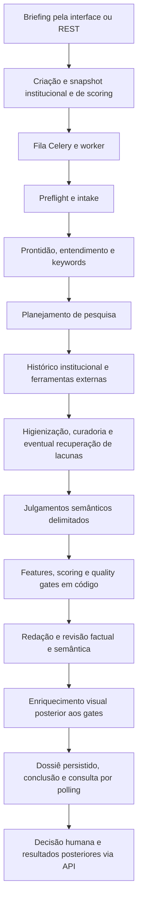

# Auditoria do sistema e do código — Prometeus — 04/11/2026

**Produto:** Prometeus — Inteligência para Produtos Educacionais.
**Mantenedora:** Agência Prometeus. **Contexto:** análise de viabilidade de novos cursos da ENS.
**Commit examinado:** `a631aa85f06cb7807b4120e2aaae74cabbbd2ccb`.
**Parecer:** não aprovar homologação final ou produção com base no estado auditado. Não há sustentação para “100% correto” ou “10/10”.

## Conclusão executiva

Existe uma implementação substancial, com separação entre domínio, aplicação e fornecedores, scoring determinístico, fontes rastreáveis, checkpoints persistidos e tratamento explícito de insuficiência. A suíte possui 650 casos. Isso é uma base relevante, mas não demonstra a correção do percurso entregue ao usuário.

O principal bloqueio é a integridade do dossiê apresentado: depois de verificar os fatos, o sistema acrescenta preços, custos, cenários, personas, currículo e conclusões estratégicas sem a mesma verificação. Uma proposta vazia e sem evidências produz preço recomendado de R$ 2.400, lucro base de R$ 23.950 e afirmações de forte demanda. Outro caso apresenta lucro com 54 alunos para uma turma de capacidade 30. Portanto, a apresentação pode contradizer o resultado analítico protegido pelo próprio backend.

Há também falhas reproduzidas de cancelamento, publicação na fila, idempotência, persistência concorrente e backup JSON, além de ausência de autenticação/autorização nas rotas examinadas. MCP e webhook não completam a integração operacional prometida. Aprovações anteriores de gates não substituem homologação atual: a avaliação legada do JEV usa o gabarito como resposta.

Foram consolidados **13 achados: nove P1 e quatro P2**. P1 significa correção necessária antes de aprovar o uso correspondente; P2 indica falha relevante de integração, operação ou qualidade. As classificações são prioridades desta auditoria de produto e software; o relatório de segurança usa sua própria escala de risco.

## Escopo e método

- Leitura da documentação canônica, decisões arquiteturais e relatórios anteriores, confrontada com código atual de entradas, workflow, persistência, coleta, scoring, síntese, revisão e frontend.
- Revisões delegadas de lógica analítica, workflow e segurança, com validação adversarial por revisor diferente para achados operacionais e de segurança. Os achados analíticos foram inspecionados e suas provas reexecutadas pelo auditor principal.
- Execução da suíte existente, lint, formatação, tipagem e validação documental, em Python 3.11.9.
- Provas isoladas com SQLite, provedores simulados e arquivos temporários. Testes com fakes demonstram defeitos da aplicação; não certificam os provedores.
- Inspeção somente de leitura do inventário Docker: API publicada em `0.0.0.0:8000` e `0.0.0.0:1455`, também em IPv6. Não houve exploração do stack ativo.
- Nenhum código da aplicação foi corrigido; foram criados relatório e artefatos de auditoria. O DOCX não rastreado previamente existente foi preservado.

Esta é uma auditoria sistêmica focada nos caminhos críticos e nas divergências com a proposta. Não é uma prova formal de todos os caminhos do programa. Não foram acionados CRM ENS, JEV, LLM ou Actors reais, nem realizada uma nova homologação paga de ponta a ponta. Os testes live existentes permaneceram sob seus controles de opt-in. Não houve avaliação de firewall/proxy externo, teste de carga, ensaio real de desastre PostgreSQL/Redis, varredura completa de CVEs ou comparação de recomendações com decisões reais da ENS.

## Auditoria 1 — entendimento do sistema e fluxo real

O runtime é um monólito modular com FastAPI, interface JavaScript, PostgreSQL, Celery e Redis. O processamento é coordenado por `RunCourseAnalysis`, com 15 checkpoints sequenciais. Serviços especializados, prompts e skills distribuem responsabilidades; não foi encontrado um enxame de agentes autônomos executando o fluxo principal de forma independente. Isso não impede cumprir o objetivo, mas delimita o significado de “multi-agent”.

O diagrama representa a sequência observada, incluindo o enriquecimento que causa A01/A02. A publicação na fila antes do commit é uma falha de implementação nessa sequência (A05).

| Checkpoints | Responsabilidade observada |
|---|---|
| 1–3 | Prontidão do runtime, normalização e prontidão semântica da proposta; pode aguardar entrada |
| 4–6 | Entendimento do curso, keywords e plano de pesquisa |
| 7–9 | Histórico interno, execução externa, sanitização/qualificação e recuperação limitada de lacunas |
| 10–12 | Julgamento curricular, features verificadas, cálculo e gates da recomendação |
| 13–15 | Geração/revisão, persistência, confirmação do status do dossiê e conclusão |

No modo `traditional`, o `LLMDecisionAdapter` realiza os julgamentos delimitados; no `hybrid`, o JEV assume esses julgamentos e a LLM permanece no planejamento e redação. O ADR-0008 substitui a obrigação global do JEV descrita em documentos anteriores. Fórmulas e estados permanecem em código. O modo `auto` escolhe pela configuração da credencial, sem provar disponibilidade do fornecedor.

O Compose seleciona `portfolio-v2`, cujo próprio YAML declara `status: hypothesis` e “Hipótese não calibrada”. O perfil separa score observado, cobertura e confiança, exige histórico interno e busca, e permite que insuficiência prevaleça sobre uma nota elevada. O score é um índice experimental, não probabilidade de sucesso nem projeção financeira.

O histórico sintético ENS é uma decisão explícita de homologação. Sua existência não foi classificada como bug. O valor decisório em produção exige histórico institucional real validado, além das evidências externas.

### O que está implementado, mas não integrado ao percurso principal

- `CourseEconomicsService` contém cálculo em Decimal e controle de capacidade, porém o dossiê visual usa um cálculo paralelo (A02).
- A classe MCP é exercitada diretamente em testes; não há transporte operacional entregue nem enfileiramento pela sua ferramenta de criação (A08).
- O dispatcher de webhook tem testes e assinatura, mas o checkpoint final retorna `not_configured` (A09).
- `get_shadow_decision_service` existe, mas o worker usa `get_decision_model`; `RunCourseAnalysis` constrói `DecisionService` diretamente. Selecionar `AI_MODE=shadow` no caminho examinado fornece o adapter tradicional, sem conectar automaticamente o serviço de comparação. A qualidade do módulo isolado não comprova shadow real em produção.

## Auditoria 2 — achados priorizados

### A01 — P1: conteúdo sem evidência é acrescentado ao dossiê depois da verificação

**Código:** `src/prometeus/application/synthesize_dossier.py:712`, `:722`, `:891`, `:1105`, `:1122`; `web/js/views/dossier-view.js:654`, `:719`, `:758`, `:764`.

`_verify_generated_dossier` verifica `DossierOutput`. Depois desses gates, `_build_visual_presentation_blocks` fabrica defaults e afirmações e os mescla em `presentation`, persistida junto ao status verificado. A UI usa esses blocos para KPIs, economia, personas e SWOT.

**Prova:** proposta vazia, zero evidências e recomendação `INSUFFICIENT_EVIDENCE` resultam em preço recomendado R$ 2.400, custos fixos R$ 15.000, custo variável R$ 452,50, lucro base R$ 23.950 e margem 49,9%. Para um curso de Python, surgem personas jurídicas, “vácuo competitivo” e “forte demanda corporativa B2B”. A prova chama o helper com fatos controlados; a conexão dele à persistência e UI foi confirmada por código. Não se afirma que uma LLM real aprovaria uma proposta vazia.

**Impacto:** informações comerciais sem base parecem validadas e podem induzir lançamento ou precificação inadequados, mesmo que a recomendação técnica seja prudente.

**Correção e aceite:** retirar os defaults afirmativos, renderizar dados do contrato canônico e submeter todo conteúdo decisório exibido aos gates. Ausência de premissas deve produzir “não calculável/não informado”. Testar a resposta REST e o HTML final, incluindo o caso de insuficiência.

### A02 — P1: cálculo visual admite equilíbrio inexistente e ocupação acima da capacidade

**Código:** `src/prometeus/application/synthesize_dossier.py:737` a `:768`; contraste com `src/prometeus/application/economics_service.py:24`.

O helper transforma contribuição negativa em positiva com `max(1.0, ticket - variable_cost)` e força o número de alunos dos cenários a superar o equilíbrio, sem respeitar capacidade. O cenário base recebe `status: positive` independentemente do resultado.

**Provas:** capacidade 30, ticket R$ 2.400, custo fixo R$ 100.000 e variável R$ 452,50 produzem equilíbrio 52 e cenário base de 54 alunos, ocupação 180%, com lucro. Ticket R$ 100 com variável R$ 452,50 produz falso equilíbrio 15.000, cenário base 15.002 e prejuízo R$ 5.303.205 marcado positivo.

**Correção e aceite:** integrar o serviço econômico canônico, validar premissas e capacidade, manter equilíbrio inexistente quando contribuição não positiva, e derivar o status do resultado. Exigir regressões para contribuição negativa, capacidade insuficiente e custos ausentes. A correção matemática não basta para sanar o conteúdo fabricado de A01.

### A03 — P1: rotas de leitura, decisão e administração não autenticam nem autorizam o caller

**Código:** `src/prometeus/entrypoints/rest/app.py:95`, `:345`, `:736`, `:1255`; `src/prometeus/domain/configuration.py:375`; `compose.yaml:41`.

As rotas examinadas não exigem um principal autenticado. A decisão aceita `user_id` e `user_role` do corpo; configurações globais podem ser alteradas sem escopo administrativo. `SERVICE_API_KEYS` é declarado, mas não aplicado como controle nessas entradas.

**Prova HTTP isolada:** listagem anônima retorna 200; decisão com identidade de diretor forjada retorna 201; alteração anônima de `OPENAI_BASE_URL` e orçamento retorna 200 e grava somente o arquivo temporário da prova.

**Condição e impacto:** qualquer caller com conectividade à API recebe esses poderes. As portas locais estão publicadas em todas as interfaces; exposição à internet depende de firewall/proxy não inspecionados. Não se afirma acesso público comprovado, extração observada de credenciais ou vazamento entre bancos institucionais isolados.

**Correção e aceite:** autenticação e autorização por operação/instituição, identidade derivada da sessão/token e proteção da porta direta quando houver proxy. Testar caller anônimo, papel insuficiente e instituição divergente. Consultar também o relatório de segurança associado.

### A04 — P1: worker sobrescreve cancelamento confirmado

**Código:** `src/prometeus/entrypoints/rest/app.py:636`; `src/prometeus/application/run_course_analysis.py:278`, `:305`, `:445`; `src/prometeus/infrastructure/db/analysis_repository.py:83`.

O worker mantém uma instância antiga do agregado e grava seu status entre checkpoints sem reler o cancelamento nem comparar versão. A entidade isolada valida transições, mas não protege duas instâncias concorrentes.

**Prova:** uma segunda sessão confirma `CANCELLED` durante a operação; ao terminar o checkpoint, a sessão do worker grava `RUNNING`. Não há interrupção/aborto de Actors conectado ao endpoint. `execute` retorna cedo para `COMPLETED`, sem equivalente para `CANCELLED`/`FAILED`.

**Correção e aceite:** concorrência otimista ou atualização condicional, verificação de cancelamento entre operações e antes de novas chamadas pagas, estados terminais preservados e aborto remoto quando suportado. Testar cancelamento antes do consumo e durante execução.

### A05 — P1: criação enfileira antes do commit e pode deixar análise sem processamento

**Código:** `src/prometeus/entrypoints/rest/app.py:243`; `src/prometeus/infrastructure/db/session.py:66`; `src/prometeus/application/run_course_analysis.py:445`; `src/prometeus/workers/tasks.py:114`.

O caso de uso faz flush; a dependência HTTP commita ao sair do `yield`. A publicação Celery acontece antes. Um consumidor rápido pode consultar uma análise ainda invisível e falhar. Falha de publicação também é capturada com resposta 202 e registro `QUEUED`, sem reconciliador entregue.

**Prova:** conexão independente vê zero análises dentro do callback de publicação; após o commit, vê `QUEUED`. Isso demonstra uma janela de corrida, não falha em toda criação. O handler de reanálise já commita antes de publicar.

**Correção e aceite:** outbox transacional ou publicação pós-commit com recuperação garantida, além de idempotência do consumidor e política de retry/reconciliação. A confirmação antecipada é o padrão do Celery, e late ACK também exige idempotência; conferir a [documentação oficial de tasks](https://docs.celeryq.dev/en/latest/userguide/tasks.html). Testar consumidor imediato, indisponibilidade da fila e queda do processo.

### A06 — P1: reanálise quebra idempotência e omite snapshot de governança

**Código:** `src/prometeus/entrypoints/rest/app.py:590`; `src/prometeus/application/create_analysis.py:55`; `src/prometeus/application/run_course_analysis.py:459`.

A reanálise copia o `proposal_data` completo, incluindo `_idempotency_key`. A criação espera no máximo uma linha por chave. Depois da reanálise existem duas, e repetir a criação original levanta `MultipleResultsFound`, em vez de recuperar a análise original. A nova análise também não recebe `ConfigSnapshotModel`; o worker usa o perfil atual em disco e pode combinar governança atual com contexto institucional copiado.

**Prova:** criação → reanálise → repetição da chave original produz `MultipleResultsFound`, no mesmo tenant. Este caso independe de deployment compartilhado.

**Correção e aceite:** chave de idempotência própria, restrição de unicidade adequada e criação canônica de revisão com snapshot explícito. Verificar retries antes/depois da revisão e mudanças de configuração entre submissão e consumo.

### A07 — P1: concorrência da sessão transforma falha técnica em julgamento de irrelevância

**Código:** `src/prometeus/application/keywords.py:66`, `:82`, `:88`; `src/prometeus/application/decision_service.py:146`; `src/prometeus/application/run_course_analysis.py:138`, `:539`.

Até cinco tarefas usam o mesmo `DecisionService` e a mesma `AsyncSession`. O serviço faz `add/flush` concorrente; o pipeline captura a exceção e atribui `IRRELEVANT`. A chamada também omite análise/instituição nos envelopes.

**Prova:** um fornecedor fake devolve `HIGH_RELEVANCE` para todos os 15 termos, sem erros; o resultado fica com um relevante e 14 irrelevantes, acompanhado de `Session is already flushing`. Os 15 envelopes ficam sem vínculo à análise. Essa proporção é da prova, não uma taxa medida em produção.

**Limite:** o workflow persiste e valida o conjunto de keywords, mas o planejador recebe o entendimento do curso diretamente. Não atribuir automaticamente mudanças de consultas externas a esse descarte.

**Correção e aceite:** separar inferência concorrente da persistência serial ou usar sessões independentes com contratos explícitos; falha técnica deve ter estado próprio. Passar contexto de análise e testar julgamentos concorrentes com persistência real.

### A08 — P1: MCP não oferece a execução operacional prometida

**Código:** `src/prometeus/entrypoints/mcp/server.py:221`; `pyproject.toml`; `compose.yaml`.

`create_course_analysis` cria e salva uma análise, retorna `QUEUED`, mas não chama o caso de uso canônico, não grava snapshot, não aplica idempotência e não publica na fila. Não foi encontrado transporte/entrypoint MCP executável nem montagem na API. Os testes instanciam a classe e executam partes do fluxo manualmente.

**Impacto:** o chatbot não consegue usar o caminho MCP entregue para obter a análise completa conforme RF-008/ADR-0007. REST e a UI continuam sendo caminhos existentes.

**Correção e aceite:** transporte operacional explícito e criação compartilhada com REST, com teste desde um cliente MCP real até worker/dossiê. A especificação do protocolo é distinta da mera aceitação de mensagens JSON-RPC; conferir o [repositório oficial MCP](https://github.com/modelcontextprotocol/modelcontextprotocol).

### A09 — P2: conclusão não dispara webhook

**Código:** `src/prometeus/application/run_course_analysis.py:973`; `src/prometeus/infrastructure/webhooks/dispatcher.py:23`.

O checkpoint de publicação retorna literalmente `webhook: not_configured`. O dispatcher existe, mas não tem chamada no fluxo principal rastreado. Testes manuais do dispatcher não demonstram entrega automática ao chatbot.

**Correção e aceite:** conectar eventos persistidos de conclusão/falha ao dispatcher, com retry e idempotência, e verificar entrega assinada desde a criação real. Se polling for o contrato atual, documentá-lo como tal e retirar a aprovação de webhook operacional até sua integração.

### A10 — P2: backup JSON restaura sem sete tabelas do sistema

**Código:** `src/prometeus/infrastructure/db/backup.py:31`, `:89`, `:174`; `docs/operations/backup-and-recovery.md`.

O utilitário Python lista somente dez tabelas e omite `decision_results`, `execution_envelopes`, `market_evidences`, `research_plans`, `scoring_results`, `sector_radar_snapshots` e `tool_runs`.

**Prova:** banco de origem com uma análise e um score; backup/restore retorna `RESTORED`, mas o banco destino vazio termina com zero scores.

**Limite essencial:** o `pg_dump` do Compose é um mecanismo diferente e inclui o banco inteiro; a omissão comprovada é do backup JSON documentado e testado. Não se afirma perda inevitável de todo backup de produção.

**Correção e aceite:** proteger o esquema completo ou restringir/renomear o utilitário como exportação parcial. Exigir restore com dossiê, score, evidências, decisões e linhagem, usando PostgreSQL e FKs reais, além de ensaio do procedimento operacional adotado.

### A11 — P1: gates de qualidade publicados não comprovam qualidade da IA nem calibração do perfil ativo

**Código:** `scripts/evaluate_jev.py:46`, `:80`, `:129`, `:197`; `scripts/run_backtest.py:71`; `config/scoring/portfolio-v2.yaml:3`; `docs/roadmap/release-gates.md`.

O runner legado de JEV insere `expected_output` em `_expected`, e `BenchmarkEvaluationModel` devolve esse gabarito. Executá-lo gera oito packs aprovados e “APROVADO (10/10)”, sem chamar o JEV. É uma simulação útil do mecanismo de métricas, não aferição do modelo.

O runner de backtest usa dez fixtures com features prontas, sem corte temporal ou reconstrução da informação disponível antes do lançamento. A execução com `default-v1` aprova 100%. Com `portfolio-v2`, perfil do Compose, as mesmas fixtures produzem gate rejeitado e acurácia 0%. **Esse 0% não mede a qualidade preditiva real do perfil atual:** as entradas legadas não representam o contrato IPD atual. Mostra que a evidência anterior não homologa automaticamente o perfil ativo.

Os runners mais recentes e testes adversariais offline são controles adicionais válidos; não corrigem a ausência de uma nova avaliação real e independente de modelo/perfil/dados de produção. O próprio perfil atual se declara hipótese não calibrada, enquanto o documento de gates declara AI/Score/Production ready aprovados.

**Correção e aceite:** separar testes de métricas de avaliação do modelo; eliminar acesso ao gabarito na inferência; avaliar modelos efetivos e versões pinadas; obter coortes reais com corte temporal, baseline e resultado-alvo acordados com a ENS; registrar shadow prospectivo e aprovação rastreável dos gates atuais.

### A12 — P2: metadados de diagnóstico podem executar JavaScript no portfólio

**Código:** `web/js/views/portfolio-view.js:240`; `web/js/app.js:49`; `web/js/store.js:130`; `src/prometeus/entrypoints/rest/app.py:127`, `:420`.

Nome, área, nível e modalidade são interpolados em HTML sem escape; a view é inserida via `innerHTML`. A CSP da SPA permite `unsafe-inline`.

**Prova:** Chromium isolado executa um `onerror` em `course.name`, registrando marcador de execução. Uma fixture com transições válidas `COMPLETED` e dossiê `VERIFIED` preserva o nome bruto na resposta da API e passa o filtro da store.

**Pré-condição e limite:** o portfólio recebe diagnósticos concluídos com dossiê verificado; a mera criação `QUEUED` não prova execução. A prova confirma o sink do renderer e a preservação dos metadados, não uma análise maliciosa inteira aprovada por LLM real. A classificação de segurança é média e condicionada à entrada chegar ao diagnóstico concluído.

**Correção e aceite:** `escapeHtml` ou `textContent` em todos os campos controlados, revisão dos demais sinks e CSP compatível com bloqueio de handlers inline. Testar metadados maliciosos em um diagnóstico aceito. Ver relatório de segurança.

### A13 — P2: o conjunto de checks exigido pela CI falha

**Código:** `.github/workflows/ci.yaml`; `tests/e2e/test_real_time_course_analysis.py:357`, `:465`, `:488`.

A execução da suíte tem três falhas; lint, formatação e mypy também falham. Os testes E2E esperam cinco chamadas, seis chamadas com recuperação e cinco registros, mas observam respectivamente 11, 12 e nove. A expansão recente do ecossistema pode explicar contratos de teste desatualizados; essas contagens, isoladamente, **não provam estouro de orçamento ou custo duplicado**. A falha concorrente de A07 aparece adicionalmente nos logs.

**Correção e aceite:** reconciliar contratos de pesquisa/ecossistema com expectativas e validar orçamento, preservando as garantias do teste. Corrigir tipos e higiene de código, sem apenas relaxar asserts para produzir verde. A CI deve passar no mesmo estado que será homologado.

## Verificações executadas

Os números abaixo correspondem ao estado inicial da aplicação, antes de acrescentar scripts de prova. Os artefatos de auditoria não foram tratados como código de produto.

| Verificação | Resultado observado |
|---|---|
| `python -m pytest -q` | Exit 1; 650 coletados, **642 aprovados, três falhas, cinco skips** |
| Coleta independente `pytest --collect-only -o addopts= -q` | Confirma 650 casos |
| Reexecução somente dos três E2E com JUnit | Três falhas novamente; log e XML salvos |
| `python -m ruff check .` | Exit 1; sete erros |
| `python -m ruff format --check .` | Exit 1; 75 arquivos seriam reformatados, 312 já formatados |
| `python -m mypy src` | Exit 1; 11 erros em seis arquivos, 87 arquivos examinados |
| `python scripts/validate_docs.py` | Exit 0; 165 Markdown na execução inicial |
| PoCs operacionais e analíticas | Exit 0; defeitos reproduzidos e resultados estruturados salvos |
| PoC de workflow | Exit 0; cancelamento sobrescrito, publicação pré-commit e idempotência quebrada |
| Gate C legado | Exit 0, oito packs aprovados com modelo de benchmark que recebe o gabarito |
| Gate D `default-v1` | Exit 0, dez fixtures, 100% na simulação legada |
| Gate D `portfolio-v2`, mesmas fixtures | Exit 1; contrato de dataset não homologa perfil ativo |
| Reexecução focal de controles de container, sanitização e dispatcher | Exit 0; 11 testes aprovados, sem provar integração de webhook ao workflow |
| Schema do relatório de segurança | Exit 0; dois achados válidos, um alto e um médio, com verificação independente |

Os cinco skips são um teste de schemas Apify live e quatro casos de suporte factual com LLM real. Não foram considerados testes aprovados.

## Pontos que funcionam e devem ser preservados

- Recomendação calculada em código, separada do ciclo de vida e da redação.
- Gates de cobertura, confiança, ausência de pilares obrigatórios e revisão humana.
- Snapshot de instituição/scoring na criação canônica e proveniência nas features.
- Reuso de checkpoints e resultados terminais de coleta, com explicitação de resultados parciais e lacunas.
- Atores/builds permitidos, resolução de URLs por evidências e curadoria de pertinência/finalidade.
- Distinção entre concorrentes educacionais, própria instituição e atores do radar setorial.
- Verificadores factual/semântico e revisão tripla sobre o contrato que efetivamente recebem. A01 delimita o que fica fora dessa proteção.
- Histórico sintético explicitado como tal e ausência de necessidade de JEV no modo tradicional, conforme ADR-0008.

## Aderência ao que o sistema se propõe

| Grupo de requisitos | Situação desta auditoria |
|---|---|
| Criação, prontidão, histórico e coleta (RF-001 a RF-004) | Implementados, com bloqueios de fila, keywords, cancelamento e validação real pendente |
| Decisões tipadas e cálculo (RF-005/RF-006, atualizado pelo ADR-0008) | Estrutura presente; recomendação determinística, modelos/perfil ainda sem evidência suficiente de homologação atual |
| Dossiê e exportação (RF-007/RF-012) | Contratos e endpoint presentes; conteúdo visual contorna verificação e economia canônica |
| REST/MCP/webhooks (RF-008) | REST disponível; MCP e webhook incompletos operacionalmente |
| Feedback e reexecução (RF-009/RF-010) | Rotas presentes; identidade/papel não autorizados e reanálise quebra idempotência/snapshot |
| Configuração institucional (RF-011) | Estrutura parametrizada; política de isolamento exige autenticação e deployment por instituição |
| Outcomes e backtest (RF-013) | Persistência e runners existem; validação temporal real e avaliação do perfil ativo não demonstradas |
| Reinício, escopos, snapshots e recuperação (RNF-003/004/006/008) | Garantias parciais, com falhas reproduzidas e ensaios reais ainda necessários |

## Ordem recomendada de correção e novo aceite

1. **Integridade da decisão e acesso:** eliminar o conteúdo inventado, conectar o cálculo econômico canônico e proteger as rotas. Validar o dossiê final exibido, não somente o objeto intermediário.
2. **Confiabilidade transacional:** corrigir fila/commit, cancelamento, concorrência da sessão e reanálise/idempotência; testar falhas e interrupções em PostgreSQL/Redis/Celery isolados.
3. **Completar entrega e recuperação:** integrar MCP/webhook se mantidos no escopo, corrigir backup JSON ou definir exportação parcial e ensaiar o restore adotado.
4. **Evidência de qualidade:** atualizar contratos/testes, obter CI verde, avaliar o modelo sem gabarito e homologar o perfil atual com dados reais e corte temporal.
5. **Homologação assistida com ENS:** percorrer formulário/upload → fornecedores reais → checkpoints → dossiê → evidências → reload → decisão humana, incluindo ausência legítima de evidências, falha de fonte, custo limitado e cancelamento. Registrar decisão de aceite institucional com versão e artefatos.

Uma auditoria posterior deve verificar as regressões e os critérios de aceite, além de procurar outros defeitos. Remover estes achados não equivale a prova de ausência de bugs.

## Artefatos e reprodução

- [Provas analíticas](../../../output/audit-2026-11-04/analytical-poc.py) e [resultados](../../../output/audit-2026-11-04/analytical-poc.json).
- [Provas operacionais](../../../output/audit-2026-11-04/operational-poc.py) e [resultados](../../../output/audit-2026-11-04/operational-poc.json).
- [Validação adversarial independente](../../../output/audit-2026-11-04/audit-review.md).
- [Provas de workflow](../../../artifacts/audit-2026-11-04/workflow_repro.py), [saída](../../../artifacts/audit-2026-11-04/workflow-repro-output.txt) e [análise](../../../artifacts/audit-2026-11-04/workflow-findings.md). A pasta `artifacts/` é ignorada pelo Git; preservar os arquivos junto ao pacote da auditoria.
- [Falhas E2E em JUnit](../../../output/audit-2026-11-04/failing-e2e.xml) e [log](../../../output/audit-2026-11-04/failing-e2e.log).
- [Gate C simulado](../../../output/audit-2026-11-04/gate-c-benchmark.json), [Gate D legado](../../../output/audit-2026-11-04/gate-d-default-v1.json) e [execução do perfil atual no dataset legado](../../../output/audit-2026-11-04/gate-d-portfolio-v2.json).
- [Reconhecimento de segurança](../../../.security/scans/2026-11-04/architecture.md), [prova HTTP isolada](../../../.security/scans/2026-11-04/security_probe.py), [resultado](../../../.security/scans/2026-11-04/security-probe-output.json), [resultado de navegador](../../../.security/scans/2026-11-04/browser-xss-output.json) e [verificação independente](../../../.security/scans/2026-11-04/independent-verification.md).
- [Relatório de segurança HTML](../../../.security/scans/2026-11-04/security-report.html) e [achados estruturados validados](../../../.security/scans/2026-11-04/findings.json).

Comandos principais: prefixar com `rtk proxy` e usar `.venv\Scripts\python.exe`. As provas não devem ser adaptadas para executar mutações no stack ativo; seus contratos são bancos e arquivos temporários.
