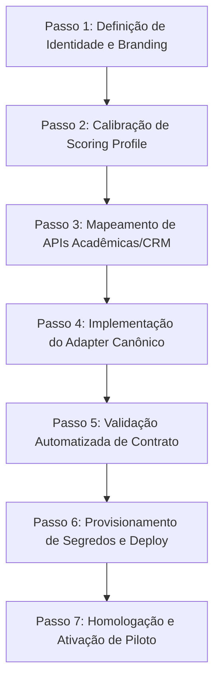

# Checklist e Guia de Onboarding Institucional (White-Label)

Este documento estabelece o processo padronizado para incorporar novas Instituições de Ensino Superior (IES) e clientes corporativos ao **Prometeus** com **zero fork de código**, preservando total isolamento relacional, segurança e personalização visual.

---

## 1. Visão Geral e Princípios Arquiteturais

1. **Monólito Configurável Sem Forks**: Novas instituições não geram branches divergentes nem forks de repositório. Toda variação institucional é expressa por:
   - Configuração do tenant (`config/tenants/<tenant>.yaml`).
   - Perfil de pontuação de viabilidade (`config/scoring/<perfil>.yaml`).
   - Conector institucional implementando a porta abstrata `InstitutionalDataAdapter`.
2. **Isolamento de Dados Relacionais**: Todas as tabelas possuem índice e chave estrangeira ou coluna `tenant_id` indexada. Backups e restaurações podem ser operados por tenant ou por banco dedicado.
3. **Tempo Alvo de Onboarding**:
   - Com conector já existente (ex.: TOTVS, Salesforce, Canvas, Moodle): **< 2 horas**.
   - Com conector novo customizado: **< 1 dia de trabalho** (desenvolvimento de mappers e contrato).

---

## 2. Checklist Operacional de Onboarding (7 Passos)



### Passo 1: Definição de Identidade e Branding
Criar o arquivo `config/tenants/<tenant_id>.example.yaml` com as informações da nova instituição:
- `institution.id`: slug único (letras minúsculas e hífens, ex.: `infnet`).
- `institution.display_name`: nome oficial da mantenedora / IES.
- `branding.product_name`: nome white-label do produto apresentado ao usuário.
- `branding.product_descriptor`: descritor comercial acordado.
- `features`: habilitação de módulos (concorrência paga, escuta social, vagas de mercado, precificação).
- `adapters.institutional`: nome do conector registrado na factory.

### Passo 2: Calibração do Perfil de Scoring
Criar `config/scoring/<perfil_id>.example.yaml` com:
- `weights`: pesos dos 6 pilares de decisão (a soma deve ser **exatamente 1.00**).
- `gates`: limiares de cobertura mínima (`minimum_coverage`) e confiança mínima (`minimum_confidence`).
- `thresholds`: notas de corte para `APPROVED` (ex.: 75 ou 78) e `APPROVED_WITH_ADJUSTMENTS` (ex.: 60 ou 65).
- `required_pillars`: pilares sem os quais o curso é reprovado ou retido para revisão humana.

### Passo 3: Mapeamento dos Dados Acadêmicos e Funil
Levantar a documentação das APIs do cliente e mapear para os schemas canônicos da porta [`InstitutionalDataAdapter`](../../src/prometeus/domain/ports/institutional_data.py):
- Catálogo de cursos $\rightarrow$ `CanonicalCourse`
- Leads, inscritos e matrículas $\rightarrow$ `FunnelMetrics`
- Ticket médio, faturamento e CAC $\rightarrow$ `FinancialMetrics`

### Passo 4: Implementação do Adaptador Institucional
1. Criar diretório em `src/prometeus/infrastructure/institutional/<tenant_id>/`.
2. Implementar `mappers.py` (normalização de modalidades, status e conversões).
3. Implementar `client.py` herdando de `InstitutionalDataAdapter`.
4. Registrar o novo adaptador em `src/prometeus/infrastructure/institutional/factory.py`.

### Passo 5: Validação Automatizada via CLI e Testes
Executar a ferramenta oficial de validação:
```bash
python scripts/provision_tenant.py validate \
  --tenant-config config/tenants/<tenant_id>.example.yaml \
  --scoring-profile config/scoring/<perfil_id>.example.yaml
```
Executar os testes contratuais da porta:
```bash
pytest tests/contract/institutional/<tenant_id>/ -v
```

### Passo 6: Provisionamento de Segredos e Isolamento de Rede
1. Adicionar as credenciais nos segredos seguros do ambiente:
   - `<TENANT>_API_TOKEN`
   - `<TENANT>_CRM_BASE_URL`
   - `<TENANT>_WEBHOOK_SECRET`
2. No caso de stack dedicada ou multi-tenant compartilhado, garantir que os logs e webhooks contenham o `tenant_id` explícito para rate limiting e auditoria.

### Passo 7: Homologação em Staging e Shadow Mode
1. Executar 5 análises históricas retroativas em `SHADOW_MODE=true`.
2. Comparar as recomendações geradas contra o histórico de matrículas reais.
3. Obter assinatura conjunta de aceite técnico da instituição.

---

## 3. Modelo Operacional: Single-Tenant vs Multi-Tenant

| Dimensão | Opção A: Multi-Tenant com Isolamento Lógico (Padrão) | Opção B: Stack Dedicada por Instituição (Enterprise) |
| :--- | :--- | :--- |
| **Instância** | 1 Monólito compartilhado | 1 Container API/Worker dedicado por IES |
| **Banco de Dados** | PostgreSQL com `tenant_id` e RLS | Banco dedicado ou Schema isolado |
| **Custos Infra** | Muito baixo (1 VPS atende dezenas de IES) | Médio (custo proporcional a nós dedicados) |
| **Complexidade** | Mínima (zero manutenção de cluster) | Baixa (definido via arquivo Compose ou Helm) |
| **Recomendação** | **Recomendado para fases 01 a 09** | Reservado para clientes com exigência estrita de isolamento físico |
