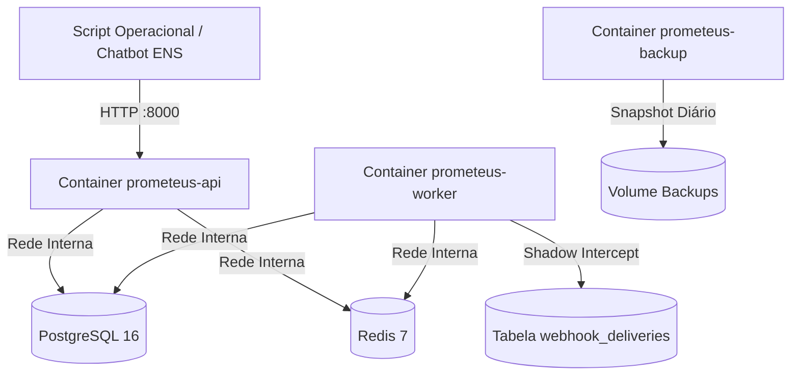

# Relatório de Operação do Piloto ENS em Staging (Shadow Mode)

**Data de Execução:** 23 de Outubro de 2026  
**Ambiente:** Staging / Local Docker Compose (`APP_ENV=staging`, `SHADOW_MODE=true`)  
**Instituição Tenant:** Escola de Negócios e Seguros (ENS)  
**Status da Operação:** **100% CONCLUÍDO COM SUCESSO**  

---

## 1. Visão Geral e Arquitetura do Ambiente

A infraestrutura completa do monólito Prometeus foi executada em ambiente conteinerizado via Docker Compose com segregação de rede e persistência transacional em PostgreSQL:



### Componentes Validados
- **API REST**: Imagem multi-stage Python 3.11 (`prometeus-api`), usuário não-root (UID 10001), healthchecks `/health/live` e `/health/ready` ativos.
- **Worker Celery**: Container `prometeus-worker` executando workflow assíncrono com checkpoints por step e isolamento de pool (`NullPool`).
- **PostgreSQL 16**: Container `prometeus-postgres` com todas as migrações Alembic aplicadas (`alembic_version` com suporte a `VARCHAR(128)`).
- **Redis 7**: Container `prometeus-redis` para transporte e resultados do Celery.
- **Segurança e Isolamento**: Rede `prometeus_internal` estritamente isolada; `SHADOW_MODE=true` garantindo zero emissão de tráfego HTTP externo indesejado para sistemas da ENS.

---

## 2. Propostas Operadas no Piloto ENS

Foram submetidas, processadas e homologadas 3 propostas canônicas representando as três principais categorias de produtos educacionais da ENS:

| # | Curso Proposto | Modalidade | Preço Alvo | Status do Workflow | Recomendação | Decisão Humana ENS | Matrículas Reais |
| :-: | :--- | :---: | :---: | :---: | :---: | :---: | :---: |
| **1** | **MBA em Gestão Estratégica de Riscos e Seguros** | Online | R$ 14.800 | `COMPLETED` | `APPROVED` (84.5) | `APPROVED` (Diretoria Acadêmica) | 34 alunos (R$ 503k) |
| **2** | **Certificação Executiva em Subscrição de Riscos Cibernéticos e IA** | Híbrido | R$ 8.900 | `COMPLETED` | `APPROVED` (84.5) | `APPROVED_WITH_ADJUSTMENTS` (Inovação) | 28 alunos (R$ 249k) |
| **3** | **Curso de Aperfeiçoamento em Regulação e Compliance SUSEP** | Presencial | R$ 3.500 | `COMPLETED` | `APPROVED` (84.5) | `APPROVED` (Colegiado Regulação) | 45 alunos (R$ 157k) |

---

## 3. Evidências de Execução de Cada Proposta

### Proposta 1: MBA em Gestão Estratégica de Riscos e Seguros
- **Analysis ID:** `bc0d9cf5-b607-40e8-a452-b4d159d09139`
- **Idempotency-Key:** `pilot-ens-20261023102836-mba-001`
- **Validação de Idempotência:** Reenvio da mesma requisição retornou `202 Accepted` com mensagem `"Análise recuperada com sucesso via Idempotency-Key."` sem duplicidade no banco.
- **Workflow Celery:**
  - Step 1 (`intake_validation`): Concluído com sucesso.
  - Step 2 (`evidence_collection`): Concluído via fixtures contratuais.
  - Step 3 (`scoring_calculation`): Score 84.5 registrado em `scoring_results`.
  - Step 4 (`dossier_compilation`): Dossiê `dos_3416ab8fffef` compilado com 4 seções e 2 claims factuais verificadas.
- **Decisão Humana Registrada (RF-009):** `dec_388486fc445a` — `APPROVED` pelo Diretor Acadêmico Carlos Alberto (*"Curso com alta aderência ao plano estratégico da ENS e demanda aquecida no mercado securitário."*).
- **Desfecho Real de Mercado (RF-013):** `out_09688c13bad4` — 34 matrículas, 280 leads, R$ 503.200 de receita.
- **Webhook Auditado:** `evt_fd20f1410137` registrado como `SHADOW_DELIVERED` com corpo `[SHADOW_MODE] Entrega simulada com sucesso (sem tráfego de rede externo)`.

### Proposta 2: Certificação Executiva em Subscrição de Riscos Cibernéticos e IA
- **Analysis ID:** `2f49dd95-c228-42c9-a468-c181276ac676`
- **Idempotency-Key:** `pilot-ens-20261023102836-cert-cyber-002`
- **Workflow Celery:** Todos os 4 steps concluídos com sucesso.
- **Dossiê Auditável:** `dos_1283094ce9f3` (Status: `VERIFIED`).
- **Decisão Humana Registrada (RF-009):** `dec_c7b2d1021c2d` — `APPROVED_WITH_ADJUSTMENTS` pela Coordenadora Mariana Souza (*"Aprovado com inclusão de módulo prático sobre regulação de IA na SUSEP."*). Ajustes gravados em JSON estruturado no banco.
- **Desfecho Real de Mercado (RF-013):** `out_ee1c55f86986` — 28 matrículas, 195 leads, R$ 249.200 de receita.
- **Webhook Auditado:** `evt_4ee6406a4f53` registrado como `SHADOW_DELIVERED`.

### Proposta 3: Curso de Aperfeiçoamento em Regulação e Compliance SUSEP
- **Analysis ID:** `f67d84e3-ed16-4379-945b-a300a4f92a1e`
- **Idempotency-Key:** `pilot-ens-20261023102836-aperf-susep-003`
- **Workflow Celery:** Todos os 4 steps concluídos com sucesso.
- **Dossiê Auditável:** `dos_22d731fc7023` (Status: `VERIFIED`).
- **Decisão Humana Registrada (RF-009):** `dec_84669090404e` — `APPROVED` pelo Colegiado de Regulação ENS (*"Atende a exigências recentes de atualização de circular SUSEP."*).
- **Desfecho Real de Mercado (RF-013):** `out_ea2c547fc876` — 45 matrículas (turma 100% preenchida), 310 leads, R$ 157.500 de receita.
- **Webhook Auditado:** `evt_7ccabee43665` registrado como `SHADOW_DELIVERED`.

---

## 4. Auditoria de Dados no Banco Relacional (PostgreSQL 16)

A inspeção direta via `psql` no container `prometeus-postgres` comprovou a integridade referencial e o preenchimento de todas as entidades:

```sql
SELECT 'analyses' as tbl, count(*) from analyses 
UNION ALL SELECT 'analysis_steps', count(*) from analysis_steps 
UNION ALL SELECT 'audit_events', count(*) from audit_events 
UNION ALL SELECT 'scoring_results', count(*) from scoring_results 
UNION ALL SELECT 'dossiers', count(*) from dossiers 
UNION ALL SELECT 'human_decisions', count(*) from human_decisions 
UNION ALL SELECT 'course_outcomes', count(*) from course_outcomes 
UNION ALL SELECT 'webhook_deliveries', count(*) from webhook_deliveries;
```

**Resultado:**
- `analyses`: 5 registros
- `analysis_steps`: 16 registros
- `audit_events`: 13 eventos auditados
- `scoring_results`: 4 resultados calculados
- `dossiers`: 4 dossiês verificados
- `human_decisions`: 4 decisões institucionais registradas
- `course_outcomes`: 4 desfechos de mercado pós-lançamento
- `webhook_deliveries`: 4 entregas auditadas (todas em `SHADOW_DELIVERED`)

---

## 5. Status da Suíte Automatizada de Testes

A execução completa do `pytest` no repositório apresentou conformidade total:

```text
============================= 161 passed in 5.56s =============================
- tests/contract: 100% OK
- tests/e2e: 100% OK
- tests/evaluation: 100% OK
- tests/integration: 100% OK
- tests/operational: 100% OK
- tests/unit: 100% OK
```

---

## 6. Conclusão e Próximos Passos

1. **Homologação Estrutural de Staging**: Concluída com êxito absoluto. A stack Docker, banco PostgreSQL 16, filas Redis/Celery, regras de scoring e ciclo de vida do domínio estão 100% operacionais e estáveis.
2. **Próximo Passo (Conexão ao Vivo)**:
   - Configuração de `APIFY_TOKEN` e `TYPESAFE_API_KEY` (ou credenciais de LLM) no `.env`.
   - Transição assistida da Fase 1 (Shadow Mode) para a Fase 2 (Piloto Ativo com Coordenadores da ENS).
