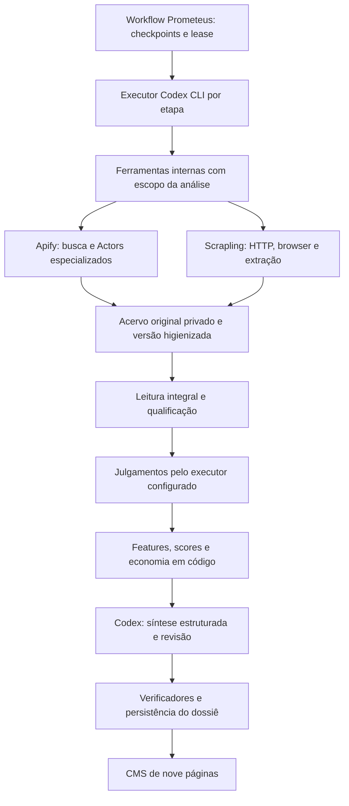

# Avaliação: Codex CLI, Apify e Scrapling no Prometeus

**Data:** 11/11/2026. **Status:** proposta técnica após inspeção do código; sem instalação, substituição de providers ou alteração de análises em andamento.

## Objetivo e fronteira

Preservar os 15 checkpoints, os seis módulos de viabilidade, os contratos de evidências e o CMS de nove páginas. Usar Codex CLI como executor das etapas inteligentes; manter Actors Apify para descoberta e fontes especializadas; avaliar Scrapling como executor de `web_crawler` e navegação de páginas acadêmicas. Firecrawl fica como alternativa futura, fora da primeira implementação proposta.

O controle do processo permanece no Prometeus. A hipótese interpretada é manter na Apify as coletas especializadas e no Scrapling o browser, com Codex dentro da infraestrutura do Prometeus. Hospedar também Codex/Scrapling em um Actor próprio é outra decisão de deployment, não requisito desta proposta.

Não há garantia antecipada de melhoria analítica, redução de custo ou ausência de bloqueios. A autenticação atual do Prometeus não equivale à autenticação do CLI. O erro de reconciliação Google Search continua uma frente independente: trocar somente `web_crawler` não o resolve.

## Constatações no código atual

| Componente | Situação observada | Consequência |
|---|---|---|
| `infrastructure/factory.py` | Providers `chatgpt_oauth` e `codex` constroem `ChatGPTPlanGenerativeClient` | O nome `codex` não executa o CLI nem seu harness |
| `domain/ports/generative_model.py` | Contrato inclui texto, geração estruturada, keywords, síntese e revisão | Há uma fronteira para adicionar adaptador CLI sem reescrever scoring |
| `workers/tasks.py` | Worker constrói `ApifyClient` e o injeta em `RunCourseAnalysis` | Um roteador de ferramentas precisa substituir essa injeção única |
| `application/collect_market_evidence.py` | `ResearchToolExecutor` retorna `ApifyExecutionResult`; persistência usa nomes Apify | A porta parece genérica, mas o contrato e a proveniência ainda são específicos |
| `application/recover_market_collection.py` | Recuperação testa `isinstance(executor, ApifyClient)`, exige registry e constrói tentativas de Actor | Um roteador simples não basta: recuperação precisa ser orientada a provider |
| `application/runtime_preflight.py` | Fontes obrigatórias são traduzidas diretamente em configurações de Actors | `web_crawler=Scrapling` requer preflight próprio |
| `infrastructure/apify/normalizers/__init__.py` | `normalize_crawler_page` já produz `OfferObservation`/`PageAcquisition`, mas nomeia fonte `apify_web_crawler` | Reutilizar o contrato de observação, preservando a origem real do novo executor |
| `application/synthesize_dossier.py` | Gera/verifica `DossierOutput`; código monta `cms_pages` | Codex pode alimentar síntese/revisão dentro do mesmo fluxo |
| `entrypoints/rest/app.py` | `_hydrate_dossier_presentation` reconstrói as páginas no GET | Gravar apenas JSON arbitrário de páginas seria insuficiente: a hidratação pode sobrescrevê-lo |
| `entrypoints/mcp/server.py` | Expõe criação, consulta e recuperação de dossiê, além de operações posteriores | Não constitui uma interface interna completa para pesquisa, ingestão e escrita de rascunhos |
| `deploy/docker/Dockerfile` | Imagem Python, sem provisionamento de Codex CLI e browser Scrapling | Instalar no desktop não habilita o worker Docker |

## Arquitetura proposta

O diagrama descreve responsabilidades. As mesmas ferramentas de coleta podem ser chamadas diretamente pelo workflow e expostas ao Codex por uma interface interna comum. Uma solicitação não deve gerar duas execuções porque foi iniciada por canais diferentes.

O Codex recebe proposta, contexto autorizado, skills de domínio, manifestações de cobertura e acesso aos artefatos higienizados. Pode solicitar aprofundamento de pesquisa ou interação de página dentro da etapa. O backend valida e registra cada operação, aplica a identidade da tarefa e mantém o lease. Sessões são vinculadas explicitamente a instituição, análise, etapa, versão de prompt/modelo e hashes de entrada; não usar retomada global por "última sessão".

## Apify e Scrapling

Apify permanece inicialmente com Google Search, Trends, anúncios, vagas e fontes sociais conforme registry homologado. URLs descobertas são validadas antes de chegar ao Scrapling. A capability lógica `web_crawler` permanece, mas ganha provider selecionado explicitamente e congelado no snapshot.

Scrapling oferece HTTP, renderização JavaScript, parsing e crawling. Seu MCP documenta sessões, ações de browser, extração, screenshots e inspeção de rede; essas capacidades permitem propor navegação assistida para abas de currículo, detalhes de preço e paginação. São funcionalidades documentadas, ainda sem homologação nos concorrentes ENS. [Projeto](https://github.com/d4vinci/Scrapling), [MCP oficial](https://scrapling.readthedocs.io/en/latest/ai/mcp-server.html).

Começar com HTTP quando suficiente, usar browser quando a página exigir e persistir cada estado que forneceu conteúdo. Sessões em memória não sobrevivem automaticamente ao reinício do container: cookies e checkpoints compatíveis precisam de política de retomada explícita, separada do progresso da análise. Três retentativas diagnosticadas continuam vinculadas à tarefa; trocar o provider não reinicia silenciosamente o contador.

O resultado deve conter provider e versão reais, identidade da execução, URLs pedida/final, status HTTP, horário, desfecho por URL, artefatos originais disponíveis, conteúdo higienizado, hashes e indicação de omissões. Para execução local, registrar consumo quando mensurável; ausência de tarifa de Actor não significa custo operacional zero.

O MCP do Scrapling documenta limites e omissões no histórico de rede, inclusive respostas não textuais e capturas incompletas. Sua saída de ferramenta não é, por si só, um arquivo integral. Precisamos de persistência própria antes da redução de contexto e download separado dos documentos pertinentes. Conteúdo higienizado é lido em partes; compaction ou resumo de sessão não comprova cobertura. [Limites documentados](https://scrapling.readthedocs.io/en/latest/ai/mcp-server.html#network-history).

## Codex CLI, MCP e skills no runtime

Adicionar um provider distinto, como `codex_cli`, preservando o significado dos providers atuais e os snapshots antigos. O adaptador precisa cumprir todos os métodos da porta generativa e a verificação de conexão real. O CLI oferece execução não interativa, eventos JSONL, saída com JSON Schema e retomada por sessão; os schemas ainda passam pela validação do Prometeus. O formato de credencial e sua renovação precisam ser verificados no runner, sem copiar tokens por suposição. [Documentação oficial](https://learn.chatgpt.com/docs/non-interactive-mode).

Recomenda-se serviço/container dedicado para o runner e serviço de browser separado, com versões fixadas. Configuração, credenciais e workspaces pertencem ao ambiente do Prometeus, sem herdar a configuração pessoal do desktop. Cancelamento/perda de lease deve encerrar o processo e as operações filhas; segredos ficam fora de prompts e logs. O runner não necessita de credenciais de administração do banco nem de permissão para editar o código de produção.

| Item | Proposta |
|---|---|
| MCP interno Prometeus | Ferramentas de pesquisa/artefatos/rascunho com escopo imposto pelo servidor; operações futuras, não existentes hoje |
| Scrapling | Dependência Python/browser no serviço de coleta; MCP ou wrapper interno para interação do Codex |
| MCP oficial Apify | Opcional para descoberta/documentação; execução inicial pelo gateway existente para preservar auditoria e recuperação |
| Skills | Empacotar e versionar as orientações atuais de pesquisa, comparação, suficiência, leitura integral, síntese e revisão para o runner Codex |
| MCP de CMS | Não é indispensável se o adaptador já retorna `DossierOutput`; necessário somente se adotarmos escrita incremental por ferramentas |

Ferramentas de rede e browser precisam preservar os controles atuais de URLs, redirecionamentos e isolamento institucional. Uma ferramenta genérica de browser não herda automaticamente as validações do cliente atual. Configurar um MCP permite chamadas; skills orientam seu uso, sem substituir validações em código. Instalações/configurações deste chat não são automaticamente as do runner.

## Cadastro e geração no CMS

Codex preenche o conteúdo analítico canônico: seções, conclusões, comparações, claims e referências. O backend verifica o rascunho, calcula os KPIs, monta o contrato visual e publica o dossiê. Assim o conteúdo chega às nove páginas existentes, mantendo o histórico de revisões e os registros humanos.

Se quisermos blocos editoriais adicionais por página, definir primeiro schema versionado e persistência como fonte canônica; depois atualizar builder e hidratação para consumi-los. Uma ferramenta futura de submissão de rascunho não pode aprovar revisões humanas, publicar sem gates ou inserir scores escolhidos pelo modelo. Não usar automação visual do próprio CMS como método principal de cadastro.

## Marcos de implementação e critérios de saída

| Marco | Entrega proposta | Critério verificável |
|---|---|---|
| 0 — Confiabilidade atual | Reproduzir divergência Google Search e recuperar datasets existentes | Leitura conciliada e nenhuma recompra de runs incertas; causa documentada |
| 1 — Contratos e ADR | Separar capability/provider, observação, artefato e recuperação | Testes com dois providers sem falsificar IDs Apify; compatibilidade dos snapshots antigos |
| 2 — Runner Codex | Provider `codex_cli`, configuração isolada, eventos e schemas | Inferência real, saída válida, retomada correta, teste de queda/cancelamento e isolamento |
| 3 — Scrapling | Serviço HTTP/browser e ingestão de conteúdo | Corpus real nos concorrentes configurados, inclusive páginas estáticas/dinâmicas, PDF e erros; manifesto sem omissões silenciosas |
| 4 — Pesquisa assistida | Codex solicita coletas/ações pelo gateway | Diagnóstico muda a estratégia; deduplicação, contador de tentativas e cancelamento preservados |
| 5 — Dossiê/CMS | Síntese e revisão por Codex nos contratos atuais | Nove páginas coerentes, KPIs provenientes do motor, claims verificadas e hidratação preservando conteúdo |
| 6 — Homologação e ativação | Comparação contra baseline e ativação por configuração | Análise real dos cinco pilares externos, avaliação factual e de cobertura, métricas de consumo e reversão testada |

Esses marcos não têm prazo estimado sem os testes de integração. Testes em corpus gravado comparam interpretação; somente coleta real compara aquisição. Não reduzir critérios para conseguir seis notas. Preservar a base sintética ENS explicitamente identificada e todos os dossiês antigos. Firecrawl não é dependência desses marcos.

## Limites da avaliação

Inspeção estática de código e documentação oficial. Nenhum CLI foi autenticado ou executado para analisar cursos nesta avaliação; Scrapling não foi instalado; não foram criados Actors, análises, rascunhos ou migrações. Não há resultado comparativo que permita declarar ganho de inteligência ou economia. Antes de implementar, registrar ADR para a nova fronteira de execução e os contratos aceitos.
